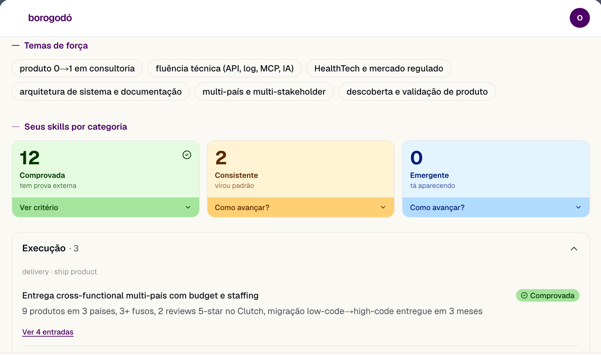

# Borogodó

**Career memory and intelligence for Brazilian professionals.**
Log what you deliver as it happens. Borogodó turns those raw notes into evidence-backed
highlights, a living "mirror" of your strengths and trajectory, and ready-to-use material
for the moments your career depends on: interviews, performance reviews, raise conversations,
LinkedIn.

🌐 **Live:** [borogodo.ai](https://borogodo.ai) · 🇧🇷 The product UI is in Brazilian Portuguese.



> *Borogodó* is a Brazilian word for that hard-to-name charm or knack that makes someone
> stand out. The product's job is to help people name theirs, with proof.

---

## The problem

Competent professionals deliver all year and still can't articulate their own value. When
review season, an interview or a promotion conversation arrives, they reconstruct their
story from memory, undersell themselves, or fall back on generic LinkedIn language. The
evidence existed; it just was never captured.

## How it works

1. **Capture without friction.** A notepad-style drawer that *always* saves, with no AI on
   the critical path. Paste text, attach images or links, dictate by voice, or import a
   LinkedIn PDF. A messy meeting note or an interview transcript is fine.
2. **Organize into highlights.** In the background, Claude extracts distinct, outcome-first
   accomplishments (what you did, the metric, the impact) from each entry. One note can
   yield several highlights, and you can re-organize anytime.
3. **See your mirror.** Highlights roll up into strength themes and skills grouped by
   category, each tagged by how solid the evidence is (*proven*, *consistent*, *emerging*)
   and linked back to the entries that support it.
4. **Use it.** Prepare for an interview, a review or a raise with a contextual chat grounded
   in your own records (retrieval over embeddings), draft a self-assessment, or generate
   LinkedIn posts, impact summaries and a mini-bio in your own voice.

## Product principles

- **No fabrication.** Every insight traces back to something the user actually recorded.
  When evidence is missing, the product asks a question instead of inventing an answer.
- **Your record is yours.** Private, portable, and independent of any employer's tooling.
- **Sounds like you, not like AI.** Generated content is checked against a ruleset of
  10 "AI tells" (em-dash overuse, hollow antitheses, bio clichés, and so on).
- **Built for Brazil.** Native Portuguese, shaped around Brazilian work culture, LGPD-compliant.

---

## How it was built

Borogodó is built solo by [Ohana Taís](https://www.linkedin.com/in/ohana-ta%C3%ADs), a Senior
Product Manager, not a software engineer, using **Claude Code** as the implementation
partner. The point of this repo is not only the product but the process: what it looks like
when a PM drives a production codebase with product discipline and an AI pair.

**Spec-driven development.** Every feature goes through the same pipeline before code is
written: product thinking → specification → clarification → technical plan → task breakdown
→ UX shaping → implementation → design/accessibility audit → multi-agent PR review.
The artifacts are all in the repo:

- [`specs/`](specs/): 27 features, each with its spec, plan, data model and tasks
- [`docs/decisions/`](docs/decisions/): product decision records (navigation architecture,
  cost controls and monetization, capture model, and others)
- [`docs/prd.md`](docs/prd.md), [`PRODUCT.md`](PRODUCT.md), [`DESIGN.md`](DESIGN.md): product
  requirements, personas, and the design system
- [`docs/aprendizados.md`](docs/aprendizados.md): a running log of lessons learned building
  with AI
- [`.claude/`](.claude/): the project's Claude Code setup, including custom skills, rules and
  hooks that *enforce* the process (for example, code can't be written on a feature branch
  until its spec exists)

*Most planning docs are written in Portuguese.*

**Engineering guardrails worth a look**

- **CI on every PR:** type check, lint, 1,100+ unit and integration tests, and a production build.
- **Voice "golden set" as a CI gate:** a deterministic, zero-cost test suite that fails the
  build if the anti-AI ruleset is weakened or a reference output stops passing.
- **AI cost brake:** per-user hourly limits, a hard daily spend cap, and operational alerts.
- **Row-Level Security** enabled on every table created in the migrations; schema changes
  ship as versioned migrations.
- **Model routing by job:** Claude Haiku for extraction, Claude Sonnet for the mirror and
  content generation; outputs validated with Zod schemas.
- **Race-safe background jobs:** a lock guards concurrent organize requests
  ([`src/lib/entries/organizingLock.ts`](src/lib/entries/organizingLock.ts)).

## Tech stack

| Layer | Choice |
|---|---|
| Framework | Next.js 16 (App Router, Server Components), React 19, strict TypeScript |
| UI | Tailwind CSS v4, shadcn/ui (Radix), Framer Motion, Lucide |
| Data and auth | Supabase: PostgreSQL, Auth (Google OAuth + email), Storage, RLS |
| AI | Anthropic API (Claude Haiku and Sonnet), OpenAI embeddings for retrieval, Zod validation |
| i18n | next-intl (pt-BR) |
| Testing | Vitest + Testing Library |
| Hosting | Vercel |

## Running locally

**Prerequisites:** Node.js 24+, a [Supabase](https://supabase.com) project (use a separate
one for development), and an [Anthropic API](https://console.anthropic.com) key.

```bash
npm install
cp .env.example .env.local   # fill in your Supabase, Anthropic and other keys
npm run dev                  # http://localhost:3000
```

Apply the SQL files in [`supabase/migrations/`](supabase/migrations/) to your Supabase
project, in order. (The base `profiles` table predates the migration history and is not yet
created by these files.)

```bash
npm run lint       # eslint
npx tsc --noEmit   # type check
npm test           # test suite
npm run build      # production build
```

Never commit `.env.local`; it is already in `.gitignore`.

## Project structure

```
src/
  app/              Next.js App Router (pages and API routes)
  components/
    ui/             base components, no business logic
    features/       feature components
  lib/
    ai/             Anthropic wrappers, prompts, content ruleset
    db/             Supabase clients and typed queries
  messages/         i18n strings
supabase/migrations/  versioned database schema
specs/              per-feature planning artifacts
docs/               PRD, decisions, brand, process, lessons learned
tests/              unit and integration tests
```

---

Questions or feedback: [admin@borogodo.ai](mailto:admin@borogodo.ai) ·
[LinkedIn](https://www.linkedin.com/in/ohana-ta%C3%ADs)
